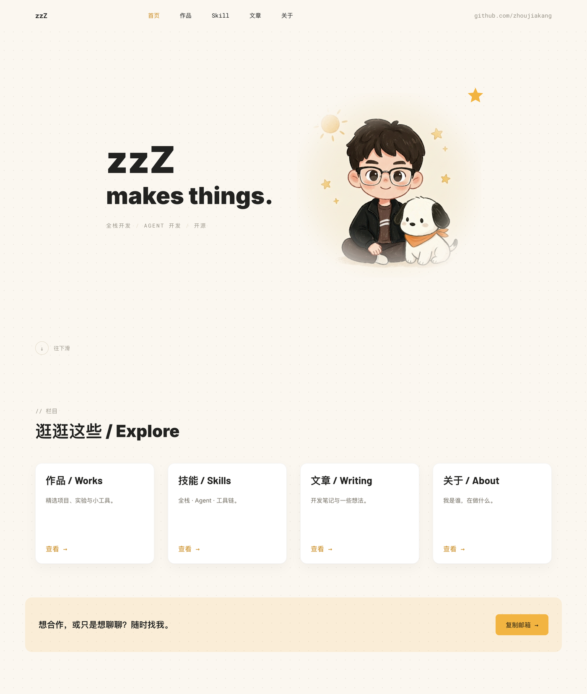
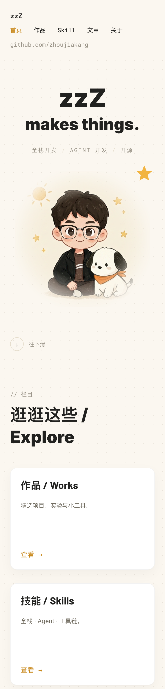

<h1 align="center">
  
  &nbsp;zzZ · makes things.&nbsp;
  
</h1>

<p align="center"><strong>把模糊的想法，变成能跑起来的东西。</strong></p>

<p align="center">
  <a href="https://blog.zzzink.cn"><strong>在线站点</strong></a> ·
  <a href="#快速开始">快速开始</a> ·
  <a href="#写内容">写内容</a> ·
  <a href="skills/README.md">建站技能</a>
</p>

<p align="center"><sub>Vue 3 · Vite 6 · 内容用 Markdown 写 · 部署在 GitHub Pages</sub></p>

## 这是什么

一个个人站点：作品、技能、文章、关于我。前端只有 **Vue 3 + Vue Router + Vite**，没有 UI 框架、没有状态管理、没有后端。

关键在于**内容和代码是分开的**——页面上每一个字都在仓库根的 `content/` 里，写成 Markdown。加一篇文章 = 新建一个 `.md`；改一句文案 = 改一行；换配色 = 改一组 CSS 变量。所以即使不写 Vue，也能自己维护这个站。

```
content/                  ← 你要动的只有这里
├── site.md               站名、导航、联系方式、各页标题、空状态文案
├── home.md               首页大标题与副标题
├── about.md              关于页：简介、Now、开始写代码的时间
├── home/*.md             首页那四张入口卡
├── works/*.md            作品（一条一个文件）
├── skills/*.md           技能
└── articles/*.md         文章
src/                      ← 结构、视图、样式
```

## 界面一览

<div align="center">

<a href=".github/assets/home.png"></a>
&nbsp;&nbsp;&nbsp;
<a href=".github/assets/mobile.png"></a>

</div>

<p align="center"><sub>桌面端：大标题 + 插画，下面是四张入口卡　｜　手机端：导航换行，标题与插画各自成行</sub></p>

<p align="center"><sub>点击图片看原尺寸。</sub></p>

## 快速开始

```bash
npm install
npm run dev      # http://localhost:5173
npm run build    # 产物输出到 dist/
npm run preview  # 预览构建结果
```

## 写内容

### 加一篇文章

在 `content/articles/` 新建 `01-hello.md`（文件名前的数字决定排序，文件名即 URL 的一部分），frontmatter 只认这几个字段：

```markdown
---
title: 为什么我把个人站重写了一遍
date: 2026.11
tag: 随笔
excerpt: 一句话摘要，会显示在列表和详情页顶部。
---

正文用 Markdown 写。

## 小标题也可以
```

列表页会按年份自动归组，顶部的标签筛选也从 `tag` 汇总生成——不需要另外维护索引。

### 加一个作品 / 一个技能

```markdown
---
title: Agent 工作流编排器
desc: 一句话说清它是什么。
tags: Agent, 工具
role: 独立开发
year: 2026
stack: Vue, Node
link: https://github.com/zhoujiakang
---

正文（可选），支持 Markdown。
```

技能更简单，只有 `title`、`content` 和正文：

```markdown
---
title: 全栈 · Agent 工具链
content: 从界面到部署都能自己走完。
---
```

### 改全站文案

站名、导航、联系方式、每个页面的标题与空状态提示，全在 `content/site.md`。改完刷新即可，不碰任何 `.vue` 文件。

### 关于页那三个数字

不用手写。**开源项目** = `content/works/` 的文件数，**分享文章** = `content/articles/` 的文件数，**写代码年限** = 由 `content/about.md` 的 `codingSince` 算到今天（支持 `2023.09`、`2023-09`、`2023/09/01` 几种写法）。加作品、加文章，数字自己会变。

### 换配色

全站颜色都是 `src/styles/global.css` 顶部的一组变量，改这里就行，组件里没有裸色值：

```css
:root {
  --bg: #fbf7f0;      /* 页面底色 */
  --ink: #222220;     /* 主文字 */
  --muted: #6f6a5e;   /* 次要文字 */
  --faint: #9a9488;   /* 标签、日期 */
  --accent: #c98a1e;  /* 强调色 */
  --yellow: #f2b441;  /* 按钮与描边 */
  --card: #ffffff;    /* 卡片 */
  --line: #e4dccb;    /* 分割线 */
}
```

字体是**自托管**的（`@fontsource` 的 Inter / Barlow / Roboto Mono），不依赖任何外网 CDN；中文缺字时回退到系统字体栈，所以不用为了几个汉字下载几 MB 的中文字库。

## 路由

| 路径 | 页面 |
| --- | --- |
| `/` | 首页：大标题 + 插画 + 四张入口卡 |
| `/works`、`/works/:slug` | 作品列表 / 详情 |
| `/skills`、`/skills/:slug` | 技能列表 / 详情 |
| `/articles`、`/articles/:slug` | 文章列表（按年归档 + 标签筛选）/ 正文 |
| `/about` | 关于我 |
| 其它 | 404 |

路由用 **hash 模式**（地址里有 `#`）。因为纯静态托管没有服务端重写，hash 能保证任何页面直接刷新、分享出去都不会 404——代价是链接不那么好看，换来的是不需要任何额外配置。

## 部署

推上去就完事：

1. 仓库 **Settings → Pages → Source** 选 **GitHub Actions**（只需设置一次）。
2. `git push origin main`，`.github/workflows/deploy.yml` 会自动构建并发布。
3. 绑定自定义域名的话，`public/CNAME` 里写域名（一行），否则每次部署都会把自定义域重置掉。

上线前记得把 `content/site.md` 里的 `siteUrl` 改成真实地址——社交分享的预览图用它拼绝对 URL，写错会导致分享卡片没图。

构建时会把 `site.md` 里的标题、描述、`og:*` 注入 `index.html`，所以分享到微信、X、Slack 时能抓到封面：

<p align="center">
  
  <br><sub>1200×630，1.91:1 —— 分享卡片用的就是这张。</sub>
</p>

## 附带的技能

`skills/personal-blog-builder/` 是一套"从零搭一个个人站"的技能包：先访谈问清需求，再按栏目搭骨架，风格做成可替换的主题层，文案全部外置。这个站就是按它做出来的。

想用它给自己或别人建站，见 [`skills/README.md`](skills/README.md)。

## 边界

- 没有后端：评论可以接 Giscus，全文搜索没有，几百篇文章就该换 Astro / Next。
- 没有后台编辑器：内容就是 Markdown，用任何编辑器写、commit 即可。
- 内容在构建期内联，所以首屏没有请求瀑布，也不会有内容闪烁。

---

<p align="center"><sub>Built with code and agents · 2026</sub></p>
