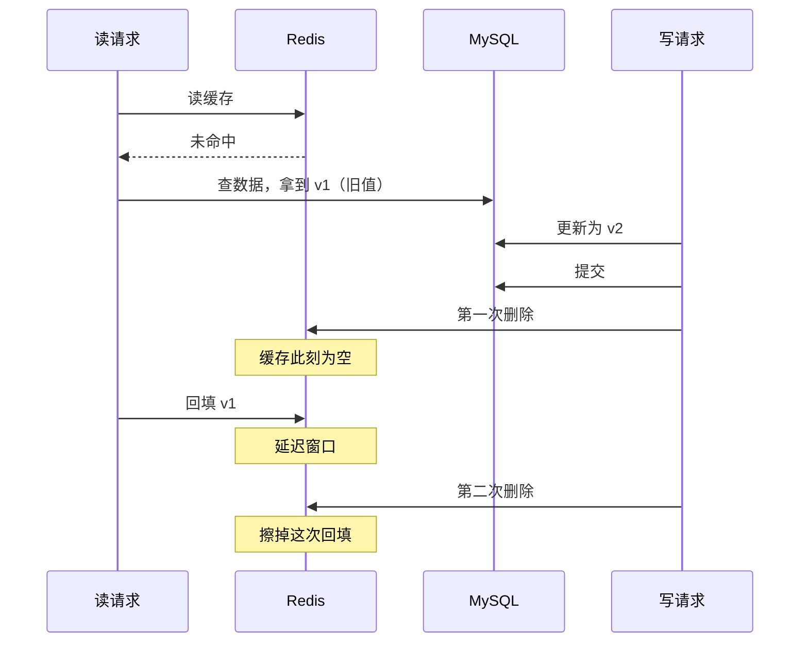
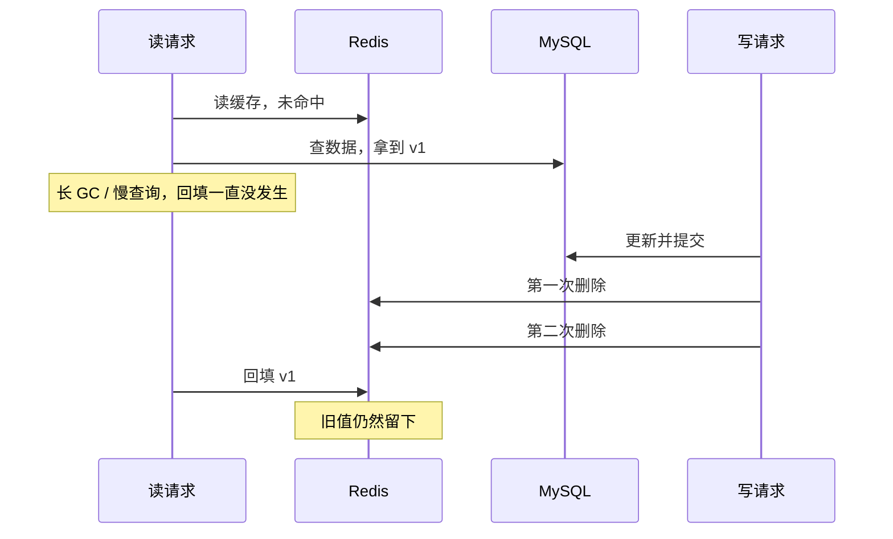

## Redis 在这里是副本，不是权威

用 Redis 给 MySQL 做旁路缓存时，Redis 是衍生副本，DB 是权威数据。通常接受短暂旧值，但必须说明失效失败后如何恢复。这里的「读到旧缓存」也应和数据库隔离级别中的「脏读」区分开。

## Cache Aside 的基本约定

| 读路径 | 写路径 |
| --- | --- |
| 1. 读 Redis | 1. 在事务中更新 MySQL |
| 2. 命中则返回 | 2. 提交 DB 事务 |
| 3. 未命中则读 MySQL | 3. 删除 Redis 缓存 |
| 4. 设置带 TTL 的缓存，再返回 | 4. 删除失败则可靠重试 |

这里强调的是 **DB 提交后**删除缓存。如果在提交前删除，读请求可能从 DB 读取尚未更新的已提交值并回填缓存，而写事务提交后没有再次失效，旧值就留了下来。

删缓存通常比直接写缓存容易处理并发：两个更新请求的缓存写入顺序可能与 DB 提交顺序相反，旧值会覆盖新值。删除操作本身则便于重复执行。

## 提交后删除仍有三个窗口

1. DB 已提交，删除缓存前，读请求仍可能命中旧值。
2. DB 已提交，但删除失败或进程崩溃，旧缓存继续存在。
3. 读请求先遇到缓存未命中、从 DB 取到旧值；写请求随后提交并删除缓存；读请求最后才把旧值回填。这时删除虽然成功，缓存仍可能变旧。

因此，提交后删除避免了「事务回滚却已写入新缓存」，但不能消除所有并发和故障窗口。

## 方式 A：事务事件监听器

下面省略依赖注入和事件类定义，重点是：**在事务中显式发布事件，成功提交后才执行监听器。**

```java
@Transactional
public void updateOrder(Order order) {
  orderMapper.updateById(order);
  publisher.publishEvent(new OrderUpdatedEvent(order.getId()));
}

@TransactionalEventListener(phase = TransactionPhase.AFTER_COMMIT)
public void onOrderUpdated(OrderUpdatedEvent event) {
  redisTemplate.delete("order:" + event.getOrderId());
}
```

事件发布时事务还没提交。事务回滚时，不会执行这个 `AFTER_COMMIT` 监听器；不能把它表述成「回滚时事件没有发布」。默认情况下，没有活动事务时也不会执行此监听器。

监听器默认同步执行；删除抛异常不会撤销已经提交的 DB 修改，还可能使调用方收到错误。因此调用方重试业务操作也应考虑幂等。

## 方式 B：注册提交后回调

```java
@Transactional
public void updateOrder(Order order) {
  orderMapper.updateById(order);
  TransactionSynchronizationManager.registerSynchronization(
    new TransactionSynchronization() {
      @Override
      public void afterCommit() {
        redisTemplate.delete("order:" + order.getId());
      }
    });
}
```

这个示例假设方法经过 Spring 事务代理调用，注册时存在活动事务。它和事件监听器一样，只是进程内回调，不是可靠消息；DB 提交后进程退出，回调可能无法执行。

## 删除失败：把失效任务持久化

较可靠的做法是在更新业务数据的**同一个 DB 事务中**记录缓存失效任务，然后由工作线程执行删除并重试。提交后回调可以用于加速触发，持久化任务负责恢复，避免「删除失败后还没记补偿记录就崩溃」的缺口。

```sql
CREATE TABLE cache_repair (
  id BIGINT NOT NULL,
  cache_key VARCHAR(255) NOT NULL,
  status TINYINT NOT NULL DEFAULT 0,
  fail_count INT NOT NULL DEFAULT 0,
  next_retry_at DATETIME NOT NULL,
  PRIMARY KEY (id),
  KEY idx_retry (status, next_retry_at)
);
```

```java
@Transactional
public void updateOrder(Order order) {
  orderMapper.updateById(order);
  repairMapper.insertPending("order:" + order.getId());
}
// 工作线程：领取到期任务 → 删除缓存 → 标记完成；失败退避重试。
```

上面是流程示意：工作线程还应处理并发领取、处理超时与告警。若删除成功后标记任务失败，重复删除是安全的。提交后如果另写补偿记录，应使用独立事务，不能依赖已经完成的原事务继续提交。

## 延迟再删与 TTL 的边界

为降低旧值晚回填的概率，可以在提交后安排立即删除和延迟再次删除。固定 500ms 不是一致性保证：慢查询、线程暂停、读副本延迟都可能超过这个间隔。

两次删除要独立调度，第一次抛异常不能阻止第二次安排。

### 第二次删除覆盖的是哪一段

把读请求和写请求放到同一条时间线上，看的是这个窗口：



第一次删除只能擦掉「提交之前」留下的缓存。T1 在删除之后才回填，等于把旧值重新放回去；第二次删除落在延迟窗口末尾，擦的正是这次回填。

覆盖不全的原因也在同一条线上：T1 的回填如果比第二次删除更晚，旧值照样留下。



延迟再删缩小窗口，不闭合窗口。

### 延迟时间怎么定

关键不在数值大小，而在这个数值和真实链路没有关系。可用的口径是「读请求从发起 DB 查询到完成回填」的 P99，再留余量：在回填的 SET 处打点，减去查 DB 的起点，就能测出来。

P99 之外总有掉队的请求。更稳的做法是让第二次删除不依赖固定时长，而依赖可观测的信号：

- 回填时把版本号或 DB 的 `update_time` 写进缓存值；
- 删除任务先读一次缓存，比较缓存里的版本与 DB 当前版本，落后才删。

另一种是「删除 + 短 TTL」的组合：TTL 兜住延迟再删覆盖不到的那段，代价是命中率下降。

### 第二次删除同样要能恢复

第一次删除失败要进 `cache_repair`，第二次也一样。把延迟当成任务的 `next_retry_at`，交给同一个工作线程，而不是内存里的 `ScheduledExecutor`：

```java
// 与第一次删除同一张表，next_retry_at = now + delay
repairMapper.insertPending("order:" + id, Duration.ofMillis(delayMs));
// 工作线程按 next_retry_at 领取；删除成功后标记完成，失败按退避重试。
```

`ScheduledExecutor` 的队列在进程内，重启即丢。延迟再删本来就是「过一会儿才做」的事，恰好是最容易跨重启丢掉的那一类。两次删除分别登记，第一次抛异常不影响第二次入表。

### 回填侧的防护

延迟再删治的是晚回填，更根本的位置在回填本身。常见三种做法，能挡的范围不一样：

| 做法 | 挡住的 | 挡不住的 |
| --- | --- | --- |
| `SET NX`，键不存在才写 | 覆盖已存在的新值 | 键被删空后，旧值仍能落进去 |
| Lua 比较版本后写入 | 旧版本覆盖新版本 | 键为空时没有可比对象 |
| 删除时 `INCR key:ver`，回填前比对版本 | 读到旧值后缓存被删过的情况 | 比对与写入之间的极窄竞态 |

第三种让回填知道「这期间缓存被删过」：读请求读到版本 N，回填前再比对一次，已经不是 N 就放弃。比对和写入不是原子的，写请求仍可能恰好挤在中间。这些手段都在回填侧降低概率，和延迟再删互补，不互相替代。

### TTL 的位置

所有缓存回填都应带 TTL，它限制的是单次旧值残留时间的上限；延迟再删是缩短窗口的手段，两者不冲突。若数据源本身是延迟副本，持续从副本回填，TTL 也保证不了最新值。

### 它和删除顺序绑定

上面的推导都建立在「提交后删除」上：第一次删除在提交之后，第二次删除在延迟窗口末尾。换成「先删缓存再更新 DB」，删除发生在提交之前，读请求在提交与回填之间的行为是另一套推导，第二次删除的时点要重新算，不能照搬。

延迟再删不是一个独立于删除顺序的通用补丁，它跟着具体路径走。

### 什么时候值得加

大多数业务不需要它。提交后删除、失效任务持久化、回填带 TTL，这三件做到位，旧值窗口通常已经在可接受范围内。

延迟再删适合旧值有明确业务影响、同时读多写少的场景：价格展示、库存显示、权益状态这类。判断依据是「读到旧值会怎样」，不是「有没有缓存」。它降低概率，不提供保证；要求更强时，方向是读写协调或直接读权威 DB，属于另一类问题。

## 小结

缓存型的基础方案是 DB 提交后删缓存，再用持久化失效任务和 TTL 兜住故障，这三样对大多数场景已经够用。延迟再删是可选项，只降低特定竞争的概率，不承诺任意时刻读到最新值；旧值有明确业务影响时再加。

## 参考

- [Spring：事务绑定事件](https://docs.spring.io/spring-framework/reference/data-access/transaction/event.html)
- [Spring：提交后回调的事务边界](https://docs.spring.io/spring-framework/docs/current/javadoc-api/org/springframework/transaction/support/TransactionSynchronization.html#afterCommit())
- [Redis：SET 命令（NX / XX / GET）](https://redis.io/docs/latest/commands/set/)
- [Redis：INCR 命令](https://redis.io/docs/latest/commands/incr/)
